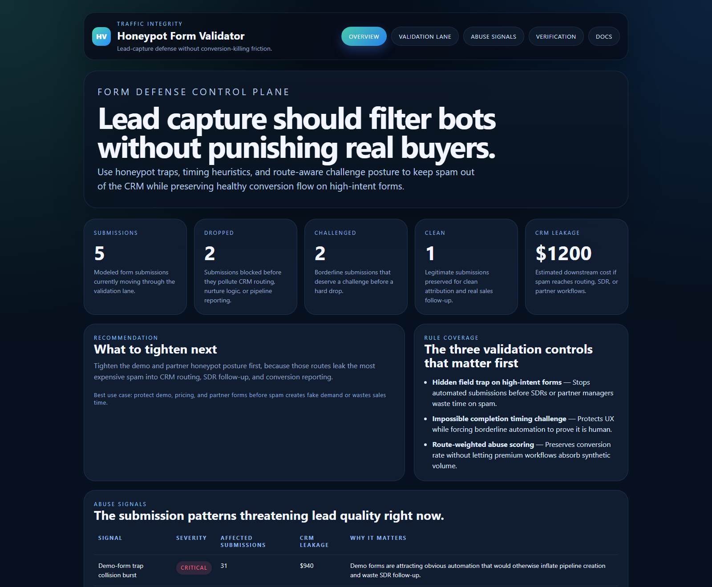
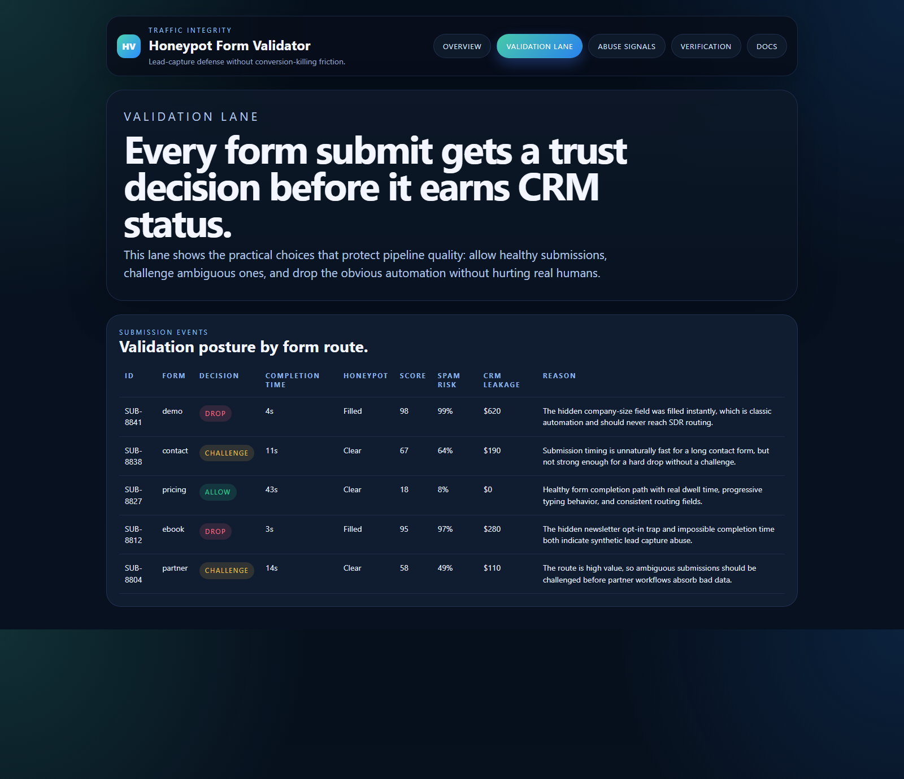
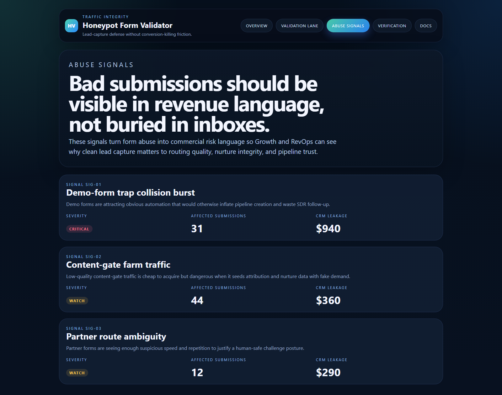
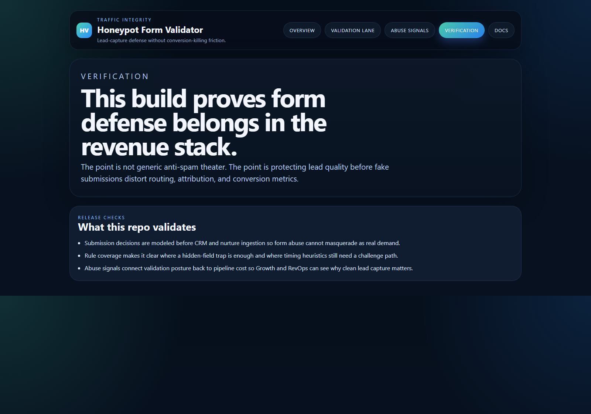

# Honeypot Form Validator

Board-ready Kinetic Gain surface for honeypot traps, submission heuristics, and UX-safe spam protection across high-intent lead-capture forms.

- Live: [http://honeypot.kineticgain.com/](http://honeypot.kineticgain.com/)
- Repo: [https://github.com/mizcausevic-dev/honeypot-form-validator](https://github.com/mizcausevic-dev/honeypot-form-validator)

## Why this exists

Form abuse is usually treated like a minor spam problem after bad data is already in the CRM. By then:
- demo queues are inflated with fake demand
- SDR follow-up time gets burned on automation
- attribution and nurture data absorb synthetic submissions
- partner and pricing workflows start reacting to junk instead of real buyer intent

`honeypot-form-validator` models the submission-integrity layer early enough to protect routing, attribution, and pipeline reporting before fake leads become false performance.

## What this product does

Honeypot Form Validator turns form submissions into a trust decision before they reach CRM, nurture, partner, or sales workflows. It separates clean submissions, challenged submissions, and hard drops so revenue teams can protect conversion quality without adding unnecessary friction for legitimate buyers.

For a SaaS go-to-market analyst, this is useful on demo, pricing, contact, assessment, and partner-intake forms where bot traffic can inflate conversion, contaminate source reporting, and waste follow-up time. It connects submission quality to campaign, routing, and lead-quality outcomes.

For a SaaS value architect, this translates spam prevention into CRM leakage, SDR time loss, attribution distortion, and nurture pollution. The business case is not just fewer spam emails; it is cleaner demand signals and less operational waste.

For technical review, the repo includes static routes, API-style outputs, seeded submission lanes, abuse-signal records, validation rules, tests, smoke checks, prerendering, and screenshot generation. It fits the broader Kinetic Gain pattern: operational evidence becomes a decision surface with owner, signal, risk, value, route, and verification visible together.

## What it includes

- TypeScript control plane for honeypot traps, submission heuristics, and UX-safe spam protection on lead-capture forms
- synthetic submission lanes across demo, pricing, partner, and contact workflows
- reusable outputs for spam risk, CRM leakage, rule posture, and trust-safe routing narratives
- prerendered static site, JSON payloads, screenshots, and docs

## Routes

- `/`
- `/validation-lane`
- `/abuse-signals`
- `/verification`
- `/docs`

## API

- `/api/dashboard/summary`
- `/api/validation-lane`
- `/api/rules`
- `/api/abuse-signals`
- `/api/verification`
- `/api/sample`

## Screenshots






## Local Development

```powershell
cd honeypot-form-validator
npm install
npm run dev
```

Open:
- [http://127.0.0.1:5346/](http://127.0.0.1:5346/)
- [http://127.0.0.1:5346/validation-lane](http://127.0.0.1:5346/validation-lane)
- [http://127.0.0.1:5346/abuse-signals](http://127.0.0.1:5346/abuse-signals)
- [http://127.0.0.1:5346/verification](http://127.0.0.1:5346/verification)
- [http://127.0.0.1:5346/docs](http://127.0.0.1:5346/docs)

## Validation

- `npm run verify`
- `npm run prerender`
- `npm run render:assets`

## Docs

- [Architecture](./docs/architecture.md)
- [Origin](./docs/ORIGIN.md)
- [Changelog](./CHANGELOG.md)
